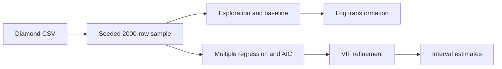

<div align="center">

# FacetDNA

### What explains the price of a diamond?

**Regression modeling, transformations, and diagnostics on a 2,000-diamond sample.**

[Read the report](reports/lm_Project.pdf) · [Explore the analysis](analysis/FacetDNA.Rmd) · [Reproduce the study](#reproduce-the-study)

[](https://www.r-project.org/)


[](https://ggplot2.tidyverse.org/)


</div>

---

## Overview

FacetDNA explores how **carat, cut, color, clarity, and physical dimensions** relate to diamond prices. The analysis samples 2,000 diamonds with a fixed random seed and develops a sequence of linear models, examining fit alongside residual behavior and multicollinearity.

The study progresses from exploratory plots to a carat-only model, a log–log transformation, multiple regression, stepwise AIC selection, variance inflation factors, and interval estimates. Its central theme is that a high R² alone is insufficient to judge a regression model.

[Methods](#methods) · [Results](#results) · [Reproduction](#reproduce-the-study) · [Files](#repository-guide)

## Methods

| Stage | Implementation | Purpose |
|:---|:---|:---|
| Exploration | Summaries, plots, correlations | Inspect distributions and related size measurements |
| Baseline | `lm(price ~ carat)` | Establish a simple price–size relationship |
| Transformation | `lm(log(price) ~ log(carat))` | Examine changes in fit and residual behavior |
| Multiple regression | Additional physical and categorical predictors | Study associations conditional on other features |
| Model selection | `MASS::stepAIC` | Select a model by AIC |
| Collinearity checks | `car::vif` | Diagnose redundant predictor information |
| Interval estimation | `predict.lm` | Compare confidence and prediction intervals |



## Results

Selected **in-sample** fit statistics from the [existing report](reports/lm_Project.pdf):

| Model | Response scale | R² | Adjusted R² |
|:---|:---|---:|---:|
| Carat-only regression | Price | 0.8505 | 0.8504 |
| Log–log regression | Log price | 0.9279 | 0.9279 |
| AIC-selected multiple regression | Price | 0.9248 | 0.9240 |
| Multiple regression after VIF refinement | Price | 0.9202 | 0.9194 |

Carat carries substantial information about price, while related size measurements create collinearity concerns. The log–log model shows improved residual behavior in the report. **R² values on price and log-price responses are not directly comparable measures of dollar-scale predictive accuracy.**

The final raw-price model produces an entirely negative confidence interval for one example diamond and a prediction interval that crosses zero. These implausible values expose a limitation of that fitted model for the example, despite its high in-sample R².

## Reproduce the study

```sh
git clone https://github.com/JimmyWu-312/FacetDNA.git
cd FacetDNA
```

Place the original CSV at `data/Diamonds Prices2022.csv`; the [data guide](data/README.md) describes the required schema. The CSV is not bundled. Open R in the repository root:

```r
install.packages(c(
  "rmarkdown", "tidyverse", "knitr", "dplyr", "kableExtra", "MASS", "car"
))

rmarkdown::render(
  "analysis/FacetDNA.Rmd",
  output_format = "pdf_document",
  output_dir = "reports",
  knit_root_dir = getwd()
)
```

The notebook uses seed **5252025** before sampling 2,000 rows. Reproducing the same sample also requires the original input row order. PDF rendering requires Pandoc and LaTeX; RStudio supplies Pandoc, and TinyTeX is one LaTeX option. An HTML version can be rendered with `output_format = "html_document"`. Package versions are not pinned.

## Repository guide

```text
FacetDNA/
├── analysis/FacetDNA.Rmd  # Complete regression study and diagnostics
├── data/README.md         # Input filename and schema requirements
├── reports/lm_Project.pdf # Original rendered report
└── README.md
```

## Scope and interpretation

- Model selection and evaluation use the same sampled data. These statistics do not establish held-out prediction performance.
- Transformations change the response scale; fit statistics and residual errors require that context.
- Visual residual checks support diagnosis rather than proving normality, constant variance, or independence.
- The source uses `price ~ .` in some models, so unexpected input columns can become predictors. Preserve the original schema, including its exported row-index column, when reproducing the archived results.
- The source calculations are preserved, with the input path adapted to the new layout. The archived PDF is unchanged.

## Author and report

**Jimmy Wu** · [GitHub](https://github.com/JimmyWu-312)

The [full report](reports/lm_Project.pdf) includes the exploratory figures, coefficient tables, model diagnostics, and interval estimates.
